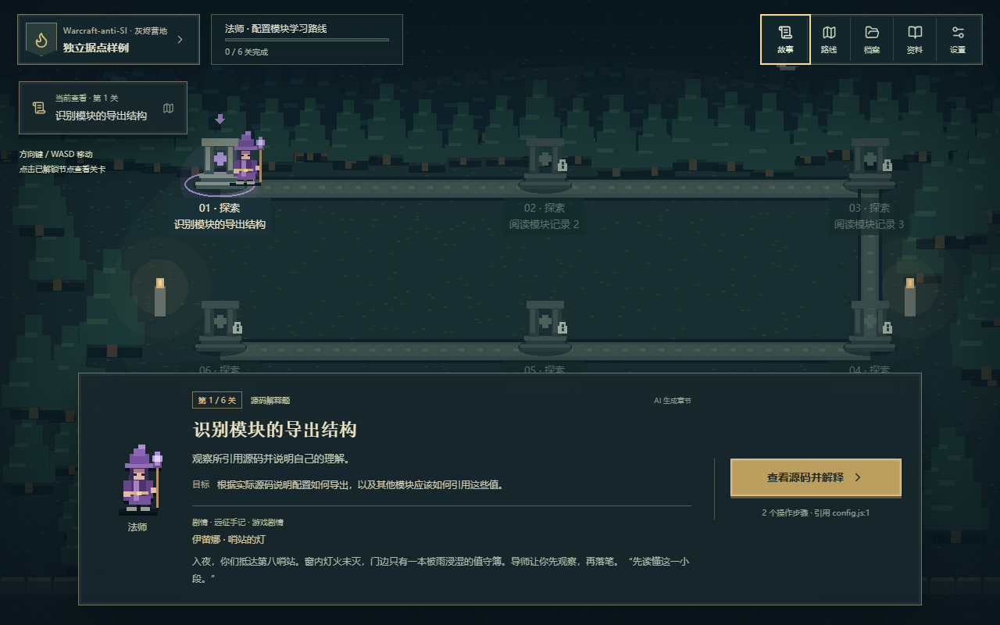
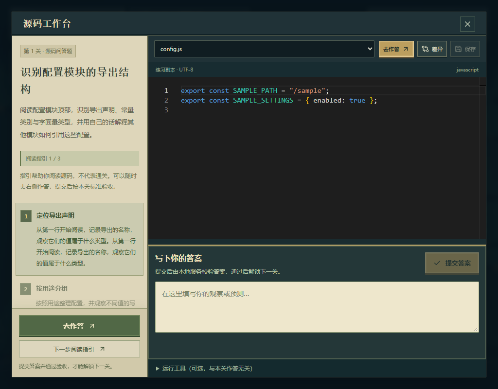

<div align="center">

# Warcraft-anti-SI

**把一个还不熟悉的代码项目，变成一段有源码、有任务、有验收的冒险。**

[开始使用](#快速开始) · [选择职业](#三位导师三种学习路线) · [使用指南](docs/USAGE.md) · [接口约定](docs/CAMPAIGN-CONTRACT.md)

</div>

AI 写出的项目能运行，你却不知道从哪里改起？

导入它，选择一位导师。Warcraft-anti-SI 会根据实际源码生成学习章节，让你从阅读、解释和预测开始，逐步修改练习副本，并用明确的验收方式检验自己的理解。它是一个在本机运行的代码学习游戏：React + Phaser 呈现营地与关卡，Monaco 提供源码工作台，Python / FastAPI 保存进度、组织模型请求与实际执行。



*实际界面截图；截图使用合成测试章节展示交互，不代表某个模型的生成质量。*

## 故事从第十三次钟声开始

王都的钟敲过十二下，仍未停。奥术中枢接管了水渠、炉火与守城法阵。工坊仍在交货，却没有学徒能说清炉火为什么亮着。

多年后，信使带来一座哨站的消息：灯还亮着，值守簿却早已无人续写。你从灰烬营地出发，带上一位导师和一枚会提出建议、也可能判断失误的“中枢残片”。

> “它说过什么，与我们亲自查明什么，分开记。”
>
> ——临行前，导师递来的空白手记

序章、人物背景与随关卡推进的对白都在游戏内。剧情保存在本地；实际学习目标来自导入的源码，通关仍取决于本关的作答或执行验收。

## 三位导师，三种学习路线

| 职业 / 导师 | 你会重点练习 | 路线如何变化 |
| --- | --- | --- |
| 法师 · 伊蕾娜，旧语抄写员 | 语言知识、源码阅读、小段逻辑 | 更多逐步讲解、预测与分级线索 |
| 圣骑士 · 加雷恩，断桥守卫 | 项目结构、实现原理、核心功能 | 沿入口与模块职责解释实现链路 |
| 德鲁伊 · 瑟芙，河源巡行者 | 全局联系、边界与功能扩展 | 先理解依赖，再尝试扩展并检查影响 |

职业会影响 AI 生成的任务内容、步骤与评审标准。已发布章节的职业固定；想换一条路线，可以重新导入为另一份练习档案。

## 从导入到下一关

1. **导入项目**：选择本地目录、单文件或 Git 地址。也可以先导入内置示例；示例同样需要模型生成章节。
2. **选择职业**：按想练习的内容选择法师、圣骑士或德鲁伊。
3. **预生成完整章节**：分批分析源码 → 规划统一路线 → 逐关生成 → 整章检查。章节包含 **6–10 关**，每关有源码位置、目标、**2–4 个步骤**及验收方式。
4. **按顺序完成关卡**：阅读指引、查看源码，再提交答案或修改练习副本。通过本关后，查看结果并点击“下一关”；后续关卡依次解锁。

生成进度来自后台实际保存的分段。失败或中断后可手动继续，兼容的已存结果会复用；刷新、重启和重新打开已生成章节不会自动发起新的生成请求。章节、进度与练习修改保存在本机。



*“去作答”定位源码下方的输入框；阅读指引的“下一步”不会提交答案。*

| 本关要求 | 完成依据 |
| --- | --- |
| 源码问答 | 本地服务核对已保存的答案 |
| 源码解释 | AI 按源码依据与本关标准评审文字回答 |
| 修改并运行 | 实际执行指定入口；输出匹配题还需满足退出码和目标输出 |
| 修改后差异评审 | 有实际改动、当前版本运行成功，再由 AI 审阅差异 |

**AI 生成内容、AI 评审与真实运行结果分别标示。** 运行成功不会自动替代 AI 审阅，AI 判断也不能代替实际运行；单个案例通过不等于整个项目正确。

## 快速开始

先准备 **Git、Python 3.11+、Node.js 22+（含 npm）**。安装脚本创建项目虚拟环境、安装项目依赖并构建前端，需要访问软件包源；Python、Node 和各语言工具链由你自行安装。

### Windows · PowerShell

```powershell
git clone https://github.com/Houlbny/Warcraft-Anti-SI-AI-.git
cd Warcraft-Anti-SI-AI-
.\setup.ps1
.\start.cmd
```

### macOS · 目标支持，尚未实测

```sh
git clone https://github.com/Houlbny/Warcraft-Anti-SI-AI-.git
cd Warcraft-Anti-SI-AI-
sh setup.sh
sh start.sh
```

打开启动终端打印的 `http://127.0.0.1:端口`。首次从 `8765` 起选择空闲端口，之后沿用保存值；在终端按 `Ctrl+C` 停止。服务仅监听本机回环地址，无需 Docker，可独立运行。

后台重启、停止服务、指定端口与更新步骤见 [使用指南](docs/USAGE.md#安装与启动)。

### 配置你的模型接口

打开游戏内“设置”，填写并保存，然后执行连接测试。

| 设置 | 填写内容 |
| --- | --- |
| `base_url` | 服务商提供的 OpenAI 兼容 API 根地址，通常以 `/v1` 结尾；远程接口使用 HTTPS |
| API Key | 远程服务所需密钥；本机回环模型服务允许留空 |
| 模型名 | 服务商实际支持的模型名称 |

当前使用 **OpenAI 兼容 Chat Completions** 协议，不同服务商的兼容程度需实际测试。应用不复用已有环境变量密钥；密钥通过系统凭据管理器或当前 Windows 用户的 DPAPI 加密保存，不以明文写入 SQLite 设置。

生成、解释评审和差异评审会把选取的源码、回答或改动等内容发送到你配置的接口，请先检查项目中的敏感内容。连接测试成功仅说明短请求可用。[密钥、超时与重试说明](docs/USAGE.md#配置模型)

## 语言与离线资料

支持 **Java、Python、JavaScript、TypeScript、Go、Bash、POSIX sh**，共 6 个适配组；Bash 与 sh 共用兼容示例。运行需要对应的本机工具链，缺少时会显示错误。Windows 不会使用 cmd 或 PowerShell 冒充 Bash / sh。[示例与工具要求](examples/)

随应用提供 **42 张中文离线知识卡**：每组 7 张，含代码、预期输出、常见误区、版本与来源，支持搜索和收藏。已保存章节可离线阅读；具备工具与依赖时，答案核对和部分运行验收也可离线完成。生成新章节、解释评审与 AI 差异评审需要可用的模型接口。

## 练习副本、存档与执行边界

- **原项目与练习区分开**：导入时复制可接受的文本源码，编辑与应用自动修复针对副本；依赖目录、生成文件、链接及明显凭据文件会被过滤。
- **本地执行拥有当前用户权限**：练习副本不是操作系统沙箱。代码、构建脚本和依赖可能访问练习目录以外的文件或网络，只运行可信项目。
- **修复范围有限**：运行失败后的自动修复仅能应用白名单内的声明式配置，最多 3 轮；业务源码、可执行构建脚本、系统安装和全局环境修改不在自动应用范围内。
- **档案可删除**：“档案 → 删除 → 确认删除”清除对应副本、进度与运行评审记录，无法撤销；原始源码、其他档案和模型设置保留。忙碌中的项目会拒绝删除。
- **存档留在本机**：默认位于 `.warcraft/`，包含副本、数据库和服务记录；不要将其公开提交。可通过 `CODEWARDEN_DATA` 调整位置。

复杂构建、外部服务、自定义测试和大型工程可能需要手动准备；章节仅覆盖本次提供给模型的源码上下文。[完整使用与限制](docs/USAGE.md)

## 开发与验证

当前实际开发与运行验证在 **Windows** 完成，已有真实模型生成与关卡游玩记录。最近一次 Windows 本地完整后台检查为 **186 passed**，前端生产构建通过；这是本地验证记录，其他系统与模型仍需分别验证。

```powershell
.\.venv\Scripts\python.exe -m pytest tests -q
cd frontend
npm run build
```

macOS 的后台检查命令为 `.venv/bin/python -m pytest tests -q`。

[使用与排查指南](docs/USAGE.md) · [基础模块与接口](docs/API-CONTRACT.md) · [章节生成与验收约定](docs/CAMPAIGN-CONTRACT.md)
